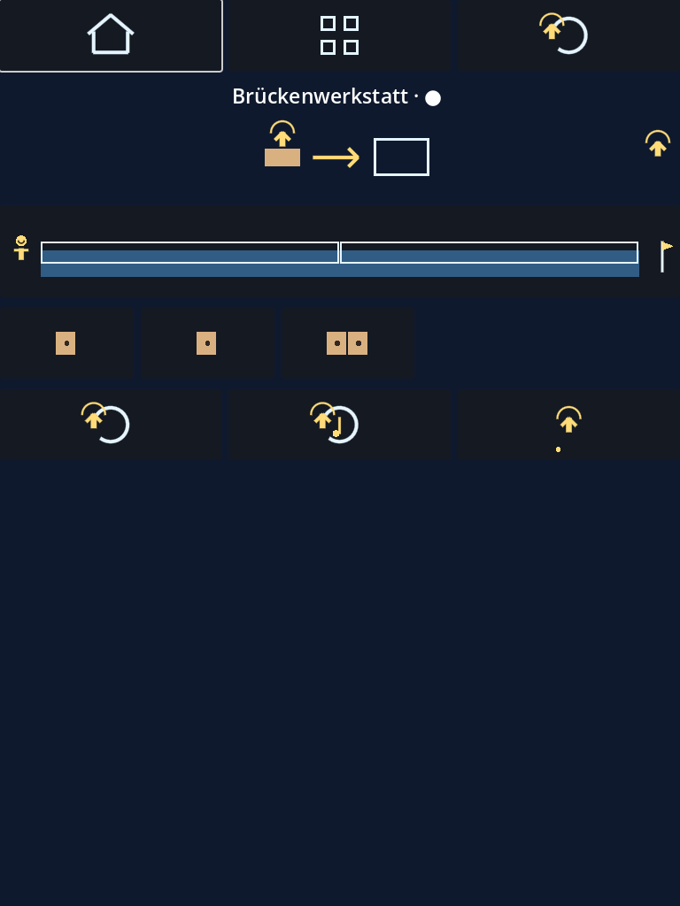
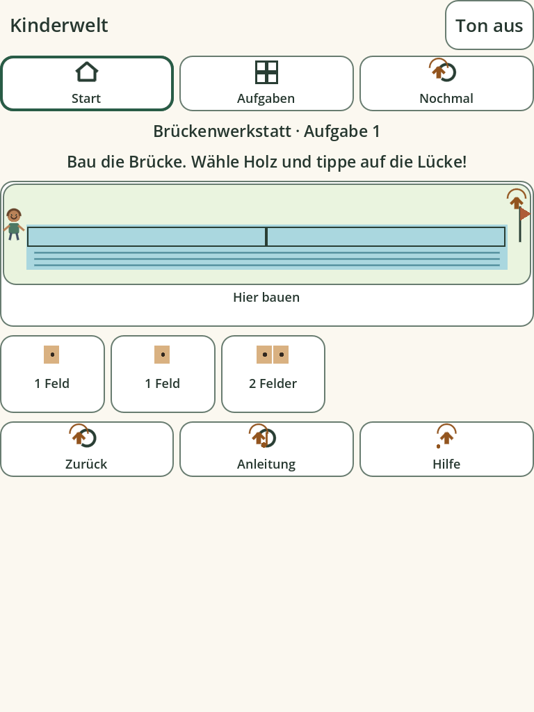

# Kinderwelt 0.2 — Child-Friendly Experience

Eigenständiger Meilenstein nach dem technischen Machbarkeitsnachweis 0.1.
Grundlage: `origin/main` `0ae6ccf` einschließlich PR #5. Branch:
`feat/child-friendly-experience`. Die fünf reinen Spielmodelle und alle 36
Aufgabendefinitionen bleiben erhalten. Es ist keine nachgewiesene Lernwirkung
oder bereits bestätigte Verständlichkeit für Siebenjährige gemeint.

## Wiederverwendbare Engine

`core/design.gd` bündelt helle Creme-/Weißflächen, dunkle Schrift, fünf dunkle
Akzentfarben, Fokusrahmen, gedrückte Zustände, Größen und Kontrastberechnung.
Die Schrift stammt aus Godots gebündelter Fallback-Schrift; deutsche Sonderzeichen
werden geprüft. Körpertext verwendet 23–26 logische Einheiten, Beschriftungen 18,
mit optional 15 % größerer Schrift. Text wird umgebrochen. Große Schrift und
Audioeinstellungen werden kompatibel im bestehenden lokalen Schema 1 ergänzt;
alte Spielstände werden nicht zurückgesetzt.

`core/mobile.gd` berechnet Androids logische UI-Größe aus Fensterpixeln und
Display-DPI statt eine 900-Pixel-Desktopoberfläche unverändert anzuzeigen.
Unplausible DPI fallen auf eine lesbare Skalierung zurück. Canvas-Items-Skalierung,
Container und Anchors übernehmen die Größenänderung. `main.gd` berücksichtigt
Androids gemeldete sichere Bereiche für Kopfzeile und Scrollbereich. Die
Simulationsoption `simulated_dpi` ist ausschließlich ein Test-Eingang; sie wird
nicht als Endnutzerfunktion angeboten.

Bei 1080×2400 und 420 DPI rendert die Testansicht mit 412×915 logischen Einheiten
und einem etwa 2,62-fachen Pixelmaßstab. Der tatsächliche Screenshot-Framebuffer
hat wegen Rundung 1080×2398 Pixel; das Manifest dokumentiert die Ist-Werte.
Die Standard-Touchziele ab 96×72/80 logischen Einheiten bleiben bei den geprüften
Dichteprofilen über dem Ausgangsziel 48 dp. Das ist eine technische Simulation,
kein physischer Größen- oder Bedienbarkeitsnachweis.

Desktop-/Headless-Tests behalten ihre echten Fensterabmessungen. Geprüft werden
320×568, 360×800, 768×1024 und 1024×768; eine zusätzliche echte Desktop-Renderprüfung
simuliert ein hochauflösendes Telefon. Hoch- und Querformat bleiben `fullUser`:
keines der fünf Modelle benötigt erzwungenes Querformat. Lange Aufgaben bleiben
vertikal scrollbar. Tablets verteilen Aufgaben in mehrere Spalten. Die
System-Schriftvergrößerung von Android wird nicht als automatisch unterstützt
behauptet; dafür gibt es den expliziten lokalen Großschriftmodus.

`main.gd` liefert eine permanente große Stummschaltung, eine illustrierte
Spielauswahl und einen getrennten Erwachsenen-/Einstellungsbereich.
`learning_game.gd` und `scenario_game.gd` teilen beschriftete Start-, Aufgaben-,
Wiederhol-, Rückgängig-, Hilfe- und Weiter-Aktionen. Hinweise bleiben freiwillig;
Fehler erlauben weitere Versuche. Eine zusätzliche Fokusregression wurde behoben:
Wiederholung markiert ein Ziel, der automatische Aufgabenstart bleibt bei der
Navigation. Der Erwachsenenhinweis erscheint nur nach aktiver Wahl des gemeinsamen
Modus oder ausdrücklichem Abruf, nicht dauerhaft im Kinderbildschirm.

## Alle fünf Bereiche

| Bereich | Tatsächliche Verbesserung |
|---|---|
| Brückenwerkstatt | Fluss, Ufer, Holzfelder, Ziel und freundliche Figur bilden eine zusammenhängende Szene. Holz wählen und auf die Lücke tippen; Felderzahl und erledigte Teile sind beschriftet. |
| Marktstand | Erkennbare Äpfel mit Stiel/Blatt und Birnen, große Körbe, sichtbare fehlende Plätze und Mengenanzeige. Vergleichen, Sortieren und Verteilen bleiben unverändert spielbar. |
| Bildergeschichte | Größere Bildkarten in zwei Spalten auf Telefonen, große Vorschau, konkrete kurze Bildnamen und beschriftete Reihenfolgeplätze. Die Geschichten behalten alle ursprünglichen Karten/Alternativen. |
| Entdeckerwerkstatt | Große aktuelle Versuchsszene, konkrete Ziele und verständlich benannte Einstellungen. „Wasser auf neuen Wegen“ zeigt Tank, Ventil, Weg und Pflanze; „Nach links / Zur Blume / Nach rechts“ und „Ventil zu / auf“ ersetzen technische Zahlen. Dieses Beispiel gehört tatsächlich zu diesem Bereich. |
| Gemeinsames Dorf | Größere Figuren mit Gesicht/Kleidung, getrennte Wünsche, ausführbare Ideen mit sichtbaren Beschriftungen. Mehrere zulässige Lösungen, Rücknahme und respektvolle Rückmeldung bleiben erhalten. |

Die Originalgrafiken sind prozedural: `world_art.gd` ergänzt echte Auswahl-/Brücken-/
Korb-Szenen, `scenario_art.gd` stellt die Geschichten, Versuche und Wünsche dar.
Das Design hat keine Abhängigkeit von einem Online-Bilddienst.

## Musik und Build

Fünf echte offline abspielbare WAV-Miniaturen und Synthesequellen sind enthalten.
[Musikherkunft und Produktionsgrenzen](music-provenance.md) erläutern die Themen,
Rechte und den noch ausstehenden musikalischen Hörtest. Der gemeinsame Manager
überblendet, pausiert im Hintergrund und trennt Musik-/Effektlautstärke; globales
Mute bleibt jederzeit erreichbar. Eine orchestrale Klangbank wird nicht vorgetäuscht.

[Testergebnisse und APK](child-friendly-test-report.md),
[Belege](child-friendly-evidence.json) und
[Smartphone-Test mit Kind](child-friendly-device-checklist.md).

Die folgenden Bilder sind echte Godot-Software-Renderings, keine Android-Aufnahmen
und keine von Kindern getesteten Entwürfe:

| Vorher, Aufgabe 0.1 | Dieselbe Brückenaufgabe in 0.2 |
|---|---|
|  |  |

[Telefon-Spielauswahl](child-friendly-screenshots/phone_hub.png) ·
[Wasser-Versuch](child-friendly-screenshots/dense-phone_autonomy-start.png) ·
[Markt](child-friendly-screenshots/phone_math-start.png) ·
[Geschichte](child-friendly-screenshots/phone_language-start.png) ·
[Dorf](child-friendly-screenshots/phone_social-start.png).
